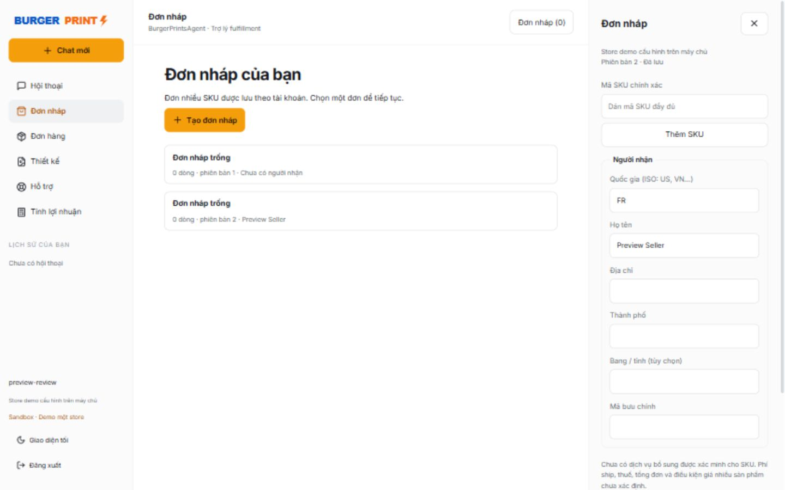

# Bàn giao thay đổi theo brief 04/11/2026

Kết quả kiểm tra tại máy ngày 04/11/2026: **33 kiểm thử backend đạt**, TypeScript đạt và **Next.js production build thành công**. Đã xem giao diện ở 1440×900 và 390×844; kiểm tra đăng nhập, tự lưu và mở lại đơn nháp sau reload bằng database preview riêng. Không dùng kết quả này để tuyên bố đã nghiệm thu giao dịch thật.



Brief gốc: [BRIEF-2026-11-04.md](BRIEF-2026-11-04.md).

## Phạm vi bản này

Triển khai mô hình **demo một store**. Tài khoản ứng dụng sở hữu hội thoại, đơn nháp, file và yêu cầu gửi đơn riêng; tất cả dùng kết nối BurgerPrints do máy chủ cấu hình. Không phải đăng nhập BurgerPrints, OAuth hoặc nền tảng nhiều store. Chưa nghiệm thu với store thật.

## Bảng hiện trạng sau thay đổi

| Nhóm | Triển khai | Giới hạn / điều kiện còn lại |
|---|---|---|
| Tài khoản ứng dụng | Đăng ký, đăng nhập, mật khẩu scrypt, cookie HttpOnly, logout thu hồi phiên | HTTPS/COOKIE_SECURE và giới hạn truy cập cần cấu hình khi triển khai |
| Lịch sử và khôi phục | SQLite theo chủ sở hữu, tin nhắn, tiêu chí tìm, kết quả gần nhất, liên kết đơn nháp | AI dùng 16 tin gần nhất và trạng thái công việc; chưa có tóm tắt ngữ nghĩa lịch sử xa |
| Tìm kiếm | Tối đa 3 sản phẩm, lọc màu/size/giá catalog trong tập ứng viên; thẻ và SKU thực tế | Thuộc tính mô tả có thể suy ra; không có lọc thời gian giao được xác nhận |
| SKU | Bỏ fallback khớp chuỗi con; chỉ mã đầy đủ (không phân biệt hoa thường) | Mã nhập thiếu phải chọn lại; không tự đổi mã |
| Catalog | Thay toàn snapshot trong một transaction; rollback nếu lỗi; lịch đồng bộ cấu hình | Một tiến trình sở hữu DuckDB; chưa có pipeline đồng bộ đa máy |
| Khả dụng | Đọc /product/outofstock có phân trang, lưu nguồn và thời điểm trong bản duyệt | Không có trong danh sách không bảo đảm nhận đơn; lỗi nguồn là unknown |
| Đơn nháp | Nhiều SKU, sửa/xóa dòng, tự lưu, số phiên bản, lưu revision | Chỉ vị trí in front trong bản demo |
| Upload / URL / thư viện | PNG/JPEG/WebP, giới hạn 25 MB, đọc giải mã file; tên, tags, tìm kiếm, phiên bản file | File lưu trên ổ máy chủ; chưa tích hợp kho object cloud hay thư viện BurgerPrints |
| Preview | Đọc chính xác blob đã lưu, liên kết đúng asset_id/file_version | Chưa có mockup sản phẩm tự sinh |
| Chuẩn in | Tách basic/print_verified; bỏ danh sách độ phân giải chung | Cần quy chuẩn SKU/xưởng/vị trí in có nguồn, phiên bản; hiện yêu cầu seller tự đối chiếu template |
| Duyệt và gửi đơn | Bản duyệt bất biến 10 phút, ràng buộc phiên bản/giá/file/cấu hình; xác nhận qua nút | API key, URL file HTTPS công khai và enable flag cần cấu hình |
| Chống trùng | SQLite BEGIN IMMEDIATE + unique(draft,version), mã tham chiếu tạo trước POST; giữ sending/verifying | Không tuyên bố upstream hỗ trợ idempotency key; không tự gửi lại khi chưa rõ kết quả |
| Tra cứu và tracking | Đối chiếu mã tham chiếu, GET đơn và tracking trong phạm vi account | Chỉ đơn gửi từ ứng dụng; chưa nhập toàn bộ lịch sử store hoặc tìm đơn tùy ý |
| Callback | URL capability riêng từng request, dedupe payload, callback chỉ kích hoạt GET nguồn; chống ghi đè fetch mới | Cần URL HTTPS truy cập từ BurgerPrints; chưa thử callback thật |
| Hỗ trợ | Lưu yêu cầu trong ứng dụng theo tài khoản | Chưa gửi ticket/email tới BurgerPrints; chưa có màn hình xử lý dành cho nhân viên |
| Lợi nhuận | Decimal, doanh thu sau giảm giá, từng phí đã nhập, margin, các khoản chưa biết; tool và giao diện | Phạm vi chi phí do seller nhập; không gọi là lợi nhuận ròng |
| Đo lường | Event theo account/entity, thống kê trong ứng dụng | Chưa có dashboard funnel/retention/latency/chi phí model đầy đủ |
| Mockup / dịch vụ / hủy / cá nhân hóa | Không giả lập chức năng | Cần template, điều kiện và phí, quy trình xác nhận và nghiệm thu riêng |

## Danh mục dữ liệu và nguồn

- Catalog: GET `/v2/product` và `/v2/product/{id}`; giữ raw_json + cached_at trong DuckDB. Chất liệu, loại, kỹ thuật in hiện suy từ mô tả và được ghi chú trong output tool.
- Khả dụng: GET `/v2/product/outofstock`, `data.result[].sku[]`, `total`; kiểm tra hết các trang trước khi nói không nằm trong danh sách hết hàng. Kết quả review chứa checked_at/source.
- Giá: `variations.price` trong catalog; không cộng giá thiếu, không áp dụng `2nd_price`/`addition_price` khi chưa xác minh ý nghĩa.
- Giao dịch: SQLite `documents`, `revisions`, `submissions`; tách khỏi DuckDB catalog. Mỗi bản ghi có owner. File nằm trong `FILE_STORAGE_PATH`, định danh bằng SHA256, không thay bytes khi đổi tên.
- Đơn: POST `/v2/order`, GET `/v2/order?reference=...&sandbox=...`, GET `/v2/order/{id}`; đối chiếu reference chính xác, không chọn phần tử đầu tùy ý.
- Tracking: GET `/v2/order/{id}/tracking`; hiển thị mã/hãng/URL nguồn, không suy ra delivered/refunded.
- Tri thức: system prompt giới hạn rõ kiến thức/giả định/dữ liệu thời gian thực; nội dung catalog là dữ liệu không được điều khiển hệ thống.
- Tài liệu chính thức: [BurgerPrints API v2](https://api-docs.burgerprints.com/), Postman collection `37932474-40489a8b-129d-479e-8a88-9da2dfc57f92`, published `2sAYQUpZPD`, đối chiếu ngày 04/11/2026. Schema tài liệu cần tiếp tục kiểm tra trên sandbox vì có ví dụ response khác phiên bản.

## Trạng thái và xác nhận

`draft vN → review vN (hết hạn sau 10 phút) → nút xác nhận → sending → created | rejected | verifying`.

- Mọi cập nhật dòng, địa chỉ, file, xác nhận tự đối chiếu template tăng version và xóa bản duyệt trên UI. Server kiểm tra version lần nữa trong transaction trước khi claim gửi.
- Giá, timestamp catalog, cấu hình store/sandbox/URL file thay đổi phải duyệt lại. Khả dụng được đọc lại trước gửi; hết hàng chặn gửi.
- `created` yêu cầu `is_success=true` và `order_id` thật. Response mơ hồ, lỗi mạng hoặc server 5xx chuyển `verifying`. Không báo thành công khi thiếu ID.
- Mỗi phiên bản chỉ claim một lần. Gửi lặp trả cùng request; sending/verifying/created khóa sửa đơn. Rejected cần sửa sang phiên bản mới trước gửi lại.
- Sending tồn quá 180 giây hiển thị verifying khi đọc danh sách; không tự retry. Nếu tiến trình chết trước POST, vẫn đối chiếu/hỗ trợ thay vì đoán chưa gửi.
- Tracking callback không tin status/body để ghi đè nguồn. Cùng body được dedupe; sự kiện đến muộn chỉ đọc trạng thái hiện tại từ API.
- Trạng thái xử lý chatbot tách khỏi state/fulfillment/payment nguồn. Không tự charge, hủy hay hoàn tiền.

## UI và trạng thái lỗi

Desktop: điều hướng trái, nội dung giữa, bảng đơn nháp khi liên quan. Dưới 900px: điều hướng và bảng đơn mở riêng. Có bốn lối vào, lịch sử và tiếp tục nháp gần nhất.

Các trạng thái có hiển thị: khôi phục phiên, đang xử lý/tìm kiếm, đang trả lời, không kết quả, chưa có giá/ảnh, khả dụng chưa xác minh, lỗi form/file/nguồn, đang lưu/chưa lưu, xung đột phiên bản, bản duyệt, đang gửi/chưa rõ kết quả/hoàn tất. Dừng trả lời dùng AbortController và nêu rõ không hủy đơn. Auto-scroll chỉ khi người dùng gần đáy. Điều khiển dùng button/label/fieldset và focus outline.

## Chạy local

Từ thư mục repo:

```powershell
python -m venv .venv
.\.venv\Scripts\python -m pip install -r backend/requirements.txt
Copy-Item backend/.env.example backend/.env
Copy-Item frontend/.env.local.example frontend/.env.local
```

Điền API key BurgerPrints và key model trong backend/.env. Mặc định provider mẫu là Gemini; có thể dùng BytePlus/Vertex theo config sẵn. Không đặt API key vào frontend.

Backend (thư mục backend): `..\.venv\Scripts\python -m uvicorn main:app --reload --port 8000`.
Frontend (thư mục frontend): `npm ci`, sau đó `npm run dev`. Mở [localhost:3000](http://localhost:3000), đăng ký tài khoản ứng dụng.

Catalog startup sync cần key thật. Khi thiếu key sẽ giữ cache cuối, không thay bằng catalog giả. Có thể tắt index vector để chạy nhanh; FAISS/SentenceTransformer chỉ import khi build index.

## Docker

`docker compose up --build`; frontend proxy tới backend service, không còn localhost sai trong container. Data/catalog/file nằm trên volume `backend_data`; không còn mount bắt buộc một service account theo đường dẫn cá nhân. Vertex cần cấu hình mount riêng nếu chọn provider này. Chưa chạy Docker trong môi trường kiểm tra hiện tại.

## Cấu hình trước thử gửi đơn sandbox

1. Đặt `BURGERPRINTS_API_KEY` cho store demo, `STORE_DISPLAY_NAME` đúng tên store.
2. `PUBLIC_FILE_BASE_URL` là origin HTTPS công khai của backend; route `/api/files/*` và `/api/callbacks/*` phải tới cùng backend. File capability giữ nguyên khi đổi phiên bản tên; không chia sẻ đường dẫn này ngoài fulfillment.
3. `ORDER_SANDBOX=true`, `ENABLE_ORDER_SUBMISSION=true`. Kiểm tra trạng thái sandbox thực tế với BurgerPrints trước trình diễn.
4. Seller tự đối chiếu template từng SKU, chọn file, nhập địa chỉ, xem mọi khoản chưa xác định và bấm xác nhận.
5. Kiểm tra đơn theo reference ở BurgerPrints; thử timeout/callback thật trước nghiệm thu.

Đơn thật cần `ORDER_SANDBOX=false` và `STORE_TRANSACTION_NOTICE` mô tả hệ quả giao dịch đã được chủ store xác minh, bao gồm cấu hình auto-charge. Không tự bật trong bản này.

Production cần HTTPS + `COOKIE_SECURE=true`, CORS origin cụ thể, giới hạn request upload ở reverse proxy, backup SQLite/volume/file, quản lý retention/revoke file capability, quota tài khoản/file và quy trình khôi phục. Một API worker sở hữu DuckDB; để mở rộng nhiều worker/máy cần tách catalog service hoặc snapshot read-only và dùng kho transaction/file phù hợp. Không chạy DuckDB writer đồng thời nhiều process.

## Kiểm thử và nghiệm thu

```powershell
# backend/
..\.venv\Scripts\python -m pytest tests -q
# frontend/
npx tsc --noEmit
npm run build
```

Kiểm thử tự động dùng DB riêng và giả lập toàn bộ gửi đơn: tài khoản khác không đọc nháp/file/đơn; khôi phục DB; xung đột phiên bản; sửa sau duyệt; nhiều SKU; double click; hai worker thread claim chung SQLite; phản hồi thiếu ID/5xx/timeout không retry; đổi giá; file hỏng và phiên bản; exact SKU; rollback catalog; Decimal; callback lặp và cũ; stock phân trang và lỗi nguồn.

Chưa nghiệm thu live: đổi ngôn ngữ và ngữ cảnh với model thật, API tạo đơn/tracking/callback của store, URL file từ phía fulfillment, mạng timeout ở hạ tầng thật, chính sách thanh toán, dịch vụ bổ sung và print template theo SKU. Không coi unit test thành bằng chứng đã tạo đơn thực tế.

## Kế hoạch tiếp theo theo brief

1. Hoàn tất nghiệm thu A–C trên sandbox bằng key/store và endpoint HTTPS phù hợp; bổ sung long-context summary có nguồn và nhập đơn cũ được phân quyền.
2. Chuẩn hóa bảng quy chuẩn theo SKU/partner/position, nguồn/version/checked_at; validate effective PPI khi có kích thước in thực. Có dữ liệu mới bật mockup 2D cho template đã kiểm tra.
3. Xác minh danh sách và phí dịch vụ theo SKU/destination, chỉ hiển thị lựa chọn áp dụng và truyền đúng trường API; không tự ép standard hoặc dùng design làm mockup.
4. Tích hợp kho file cloud/retention, dashboard funnel/latency/model cost; quản lý ticket nhân viên và kênh thông báo có opt-in.
5. Hủy đơn: xác minh điều kiện/state/auto-charge, refresh trạng thái trước, xác nhận hậu quả và đối chiếu kết quả; không suy ra hoàn tiền. Hiện dùng yêu cầu hỗ trợ nội bộ.
